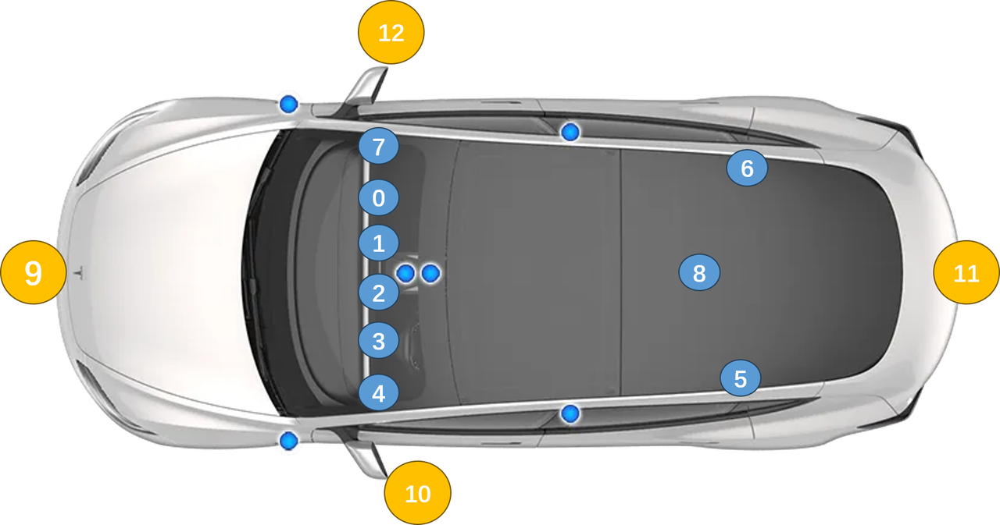

- cam_0：右侧前视相机（位于汽车前挡风玻璃）
- cam_1：广角相机（位于汽车前挡风玻璃）
- cam_2：长焦相机（位于汽车前挡风玻璃）
- cam_3：左侧前视相机（位于汽车前挡风玻璃）
- cam_4：左侧后视相机（位于汽车前挡风玻璃上方）
- cam_5：左侧前视相机（位于汽车后挡风玻璃上方）
- cam_6：右侧前视相机（位于汽车后挡风玻璃上方）
- cam_7：右侧后视相机（位于汽车前挡风玻璃上方）
- cam_8：后视相机（汽车顶部靠后位置）
- cam_9：前视鱼眼（汽车前方）
- cam_10：左视鱼眼（汽车左后视镜处）
- cam_11：后视鱼眼（汽车后方）
- cam_12：右视鱼眼（汽车右后视镜处）

